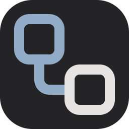

# Relay

**See what’s holding the team back. Keep work moving.**

Relay turns Google Calendar events into a shared map of work. Using AI to identify dependencies, it reveals how tasks connect, which ones need to happen first, and where delays could hold up the team.

An interactive graph makes those connections visible, while a list view separates blocking and non-blocking tasks. Search, owner filters, and sorting help teams focus. Each task includes its prerequisites, downstream impact, priority breakdown, and evidence supporting its dependencies.

Desktop notifications alert users to high-impact bottlenecks. Predefined queries help teams plan an owner’s work before a deadline, assess the impact of a delay, trace blockers, and find which task would unblock another teammate.

## From calendars to connections

Relay reads Calendar events and analyses their descriptions to identify relationships between tasks. It distinguishes between two types of dependency:

- **Hard dependencies:** a task cannot move forward until its prerequisite is complete.
- **Soft dependencies:** a task can proceed, but completing another task first would improve its outcome.

Each identified connection includes a supporting excerpt and a confidence score. Opening a task makes that reasoning available alongside its prerequisites and dependents.

Relay can work with one Calendar or combine multiple members’ Calendar snapshots through a shared coordinator. Calendar access is read-only, and Google authorization tokens remain on each member’s computer.

## Understand the impact of a task

Relay follows dependencies beyond the next task. It distinguishes direct dependents from work affected further down the chain and counts how many coworkers could be affected.

Priority scores combine four factors:

| Factor | Weight | What it captures |
| --- | --- | --- |
| Downstream impact | 40% | How much work depends on the task |
| Deadline urgency | 25% | How close the task’s deadline is |
| People affected | 20% | How many coworkers depend on downstream work |
| Critical path | 15% | The task’s position along long dependency chains leading to deadlines |

The breakdown is visible in the task details, so the score has an explanation. Desktop notification support targets high-impact bottlenecks, with a cooldown to avoid repeatedly alerting users about the same task.

## Explore the same work in two ways

**Graph view** presents the organisation’s dependencies as a connected picture. Tasks flow from prerequisites to dependents, with red hotspots at the connections affected by bottlenecks. Horizontal and vertical layouts make it possible to follow the graph in either direction across the screen.

**List view** separates blocking and non-blocking tasks. Search, owner filters, and sorting help narrow the work down, while the layout collapses to one column when only one group has results.

Both views open the same task details: owner, deadline, prerequisites, downstream impact, priority breakdown, and dependency evidence.

## Ask questions that filters cannot answer

Relay includes four predefined queries for exploring connected work:

1. **Plan work:** find an owner’s task order before a deadline, accounting for dependencies and the teammates those tasks unblock.
2. **Check a delay:** see which tasks could be affected if a task slips.
3. **Trace blockers:** follow a task’s prerequisites to find what is holding it up.
4. **Unblock an owner:** find which task would free up the most work for another owner.

Answers combine a short explanation with links to the relevant tasks and highlights in the list or graph. Planning follows dependency order; it does not estimate task durations or promise that work fits into the available time.

## Credits

The app mark is adapted from [Lucide’s Workflow icon](https://github.com/lucide-icons/lucide/blob/main/icons/workflow.svg). Its ISC license is included in [assets/LICENSE.lucide](assets/LICENSE.lucide).

## Team members
